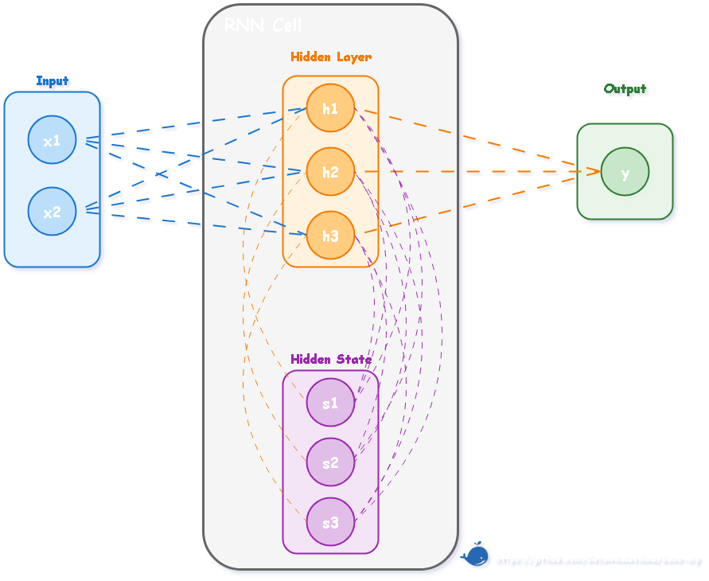

RNN 的思想是在处理序列的每一步时，网络不仅接收当前时间步的输入 $x_t$，还会接收一个来自**上一步的“记忆”**，即隐藏状态 $h_{t-1}$。网络会将这两部分信息融合，生成当前步的输出 $h_t$，并将其作为新的“记忆”传递给下一步。这种机制本质上是对全连接网络的改进，具体来说，模型会首先像全连接网络一样处理当前输入 $x_t$ 得到 $U \cdot x_t$，同时引入另一个全连接层处理来自上一步的隐藏状态 $h_{t-1}$ 得到 $W \cdot h_{t-1}$，最后将这两部分信息相加并通过一个激活函数（如 $\tanh$）得到当前步的隐藏状态 $h_t$。如此一来，$h_t$ 就同时包含了当前输入 $x_t$ 的信息和之前所有步的信息“摘要” $h_{t-1}$。
$$h_t = \tanh(U x_t + W h_{t-1} + b)$$


（1）**输入（$x_t$）**: 左侧的 `Input` 块代表当前时间步的输入向量 $x_t$。它通过权重矩阵 $U$ 连接到隐藏层（图中的蓝色虚线），对应公式中的 $U x_t$ 部分。

（2）**前一时刻的隐藏状态（$h_{t-1}$）**: 紫色的 "Hidden State" 块（图中用 $s$ 表示）代表了来自**上一个时间步**的记忆，即 $h_{t-1}$。它通过循环权重矩阵 $W$ 连接到隐藏层（图中的橙色虚线），对应公式中的 $W h_{t-1}$ 部分。

（3）**当前时刻的隐藏状态（$h_t$）**: 橙色的 "Hidden Layer" 块（图中用 $h$ 表示）代表了**当前时间步**计算出的新隐藏状态 $h_t$。它是输入信息和旧状态信息融合并经过激活函数计算后的结果。

（4）**状态更新**: 新计算出的隐藏状态 $h_t$ 将作为“记忆”传递给下一个时间步，成为下一个时间步计算中的 $h_{t-1}$（图中从 `Hidden Layer` 指向 `Hidden State` 的紫色虚线）。

（5）**输出（$o_t$）**: 当前的隐藏状态 $h_t$ 也可以被用来计算当前步的最终输出（如图中从 `Hidden Layer` 指向 `Output` 的橙色虚线），这通常需要再经过一个独立的输出层。

## 一、PyTorch 的 `nn.RNN` 实现

PyTorch 提供了高度封装的 `nn.RNN` 模块，它内部完成了与我们手写版本相同的循环计算，但经过了优化，效率更高。

```python
def pytorch_rnn_forward(x, U, W):
    rnn = nn.RNN(
        input_size=E,
        hidden_size=H,
        num_layers=1,
        nonlinearity='tanh',
        bias=False,
        batch_first=True,
        bidirectional=False,
    )
    with torch.no_grad():
        # PyTorch 内部存放的是转置后的权重
        rnn.weight_ih_l0.copy_(U.T)
        rnn.weight_hh_l0.copy_(W.T)
    y, h_n = rnn(x)
    return y, h_n.squeeze(0)
```

**`nn.RNN` 参数解析：**

  - `input_size`（$E$）: **输入向量 $x_t$ 的维度**。在 NLP 中，这通常是词嵌入的维度 `embedding_dim`。$E$ 在前面已定义。
  - `hidden_size`（$H$）: **隐藏状态向量 $h_t$ 的维度**。这代表了 RNN “记忆”的容量，也是其隐藏层的节点数。$H$ 在前面已定义。
  - `num_layers`: RNN 的层数。默认是1（即单层 RNN）。如果大于1，会构成一个“堆叠 RNN”，即前一层RNN在所有时间步的输出，会作为后一层 RNN 的输入。
  - `bias`: 是否使用偏置项。默认为 `True`。如果为真，则公式会变为 $h_t = \tanh(U x_t + b_{ih} + W h_{t-1} + b_{hh})$。在示例中设为 `False` 以便与手写版本对齐。
  - `batch_first`: 一个非常重要的维度顺序参数。默认为 `False`，此时输入张量的形状应为 `(批次大小T, 时间步长度B, 特征维度E)`。在代码中设为 `True`，使得输入形状为更符合直觉的 `(B, T, E)`，其中 `B`是批次大小，`T`是序列长度。
  - `bidirectional`: 是否构建一个双向RNN。默认为 `False`。双向RNN能同时考虑过去和未来的上下文，后续章节将对此进行介绍。

## 二、双向循环神经网络 BiRNN
### 1. BiRNN 的结构与原理

BiRNN 的原理很简单，它由两个完全独立的 RNN 构成，并将它们叠加在一起处理信息。BiRNN 包含**一个正向 RNN**，它按照从左到右的顺序读取输入序列（例如，从 $x_1$到 $x_T$），计算出一系列正向隐藏状态 $(\overrightarrow{h_1}, \overrightarrow{h_2}, ..., \overrightarrow{h_T})$；同时包含**一个反向 RNN**，它按照从右到左的顺序读取输入序列（例如，从 $x_T$ 到 $x_1$），计算出一系列反向隐藏状态 $(\overleftarrow{h_1}, \overleftarrow{h_2}, ..., \overleftarrow{h_T})$。在任意时间步 $t$，BiRNN 的最终输出 $h_t$ 则是将该时间步对应的正向 RNN 隐藏状态 $\overrightarrow{h_t}$ 和反向 RNN 隐藏状态 $\overleftarrow{h_t}$ 进行拼接（Concatenate）得到的：

$$
h_t = [\overrightarrow{h_t} ; \overleftarrow{h_t}] \tag{3.2}
$$

通过这种方式， $h_t$ 就同时包含了输入序列中 $t$ 时刻左右两侧的上下文信息。需要注意，正向和反向的两个 RNN 拥有各自独立的权重参数，它们在训练过程中被 **同时优化**。

> **为什么不直接训练两个独立的 RNN 然后合并结果？**
>
> 当然可以分别训练一个正向 RNN 和一个反向 RNN，最后将它们的输出取平均（线性意见池）或几何平均（对数意见池）。但 BiRNN 的优势在于它是在同一个损失函数下**同时训练**两个方向的权重。所以正向和反向的特征提取是协同进行的，能够更好地适应目标任务，而不需要假设两个方向的预测是相互独立的。而且，BiRNN 彻底消除了对“时间延迟”参数 $M$ 的依赖，模型自动利用所有可用的过去和未来信息。

### 2. BiRNN 的作用与局限

BiRNN 的主要**作用**是它为序列中的每个元素都提取了更完整的上下文相关的特征，而不是像单向 RNN 那样只依赖于过去的信息。尽管如此，BiRNN 仍存在**局限**，因为首先，它并没有解决 RNN 的**长距离依赖**问题，无论是正向还是反向的 RNN，它们本身依然会面临**梯度消失**或**梯度爆炸**的挑战；其次，由于需要**处理完整的序列**才能计算反向信息，BiRNN 无法被用于需要实时预测的场景（例如，根据用户已输入的内容实时推荐下一个词）。

## 三、RNN 的局限性

尽管 RNN 在理论上可以捕捉长距离依赖，但在实践中，基于 BPTT 的反向传播**在时间维度上的导数矩阵连乘**，带来了以下问题。

### 1. 梯度消失与梯度爆炸

BPTT 链式求导的关键，在于梯度的反向传播路径上会形成一个连乘项 $\prod_{i=k+1}^{t} \frac{\partial h_i}{\partial h_{i-1}}$。以 $h_i = \tanh(U x_i + W h_{i-1})$ 为例，其传播的导数矩阵近似为：

$$
\frac{\partial h_i}{\partial h_{i-1}} \approx J_{\tanh}(U x_i + W h_{i-1}) \cdot W 
$$

其中 $J_{\tanh}$ 表示 $\tanh$ 的导数矩阵。这意味着，从遥远的 $k$ 步到当前 $t$ 步的梯度传递，需要经历 $t-k$ 次与权重矩阵 $W$ 和激活函数导数矩阵的相乘。

在 RNN 中，权重矩阵 $W$ 的值通常会被初始化为较小的值，如果 $W$ 的范数（可以理解为其对向量的缩放能力）小于1，或者激活函数的导数（如 $\tanh'$ 最大为 1，通常小于 1）导致连乘项变小，那么多次相乘之后，梯度值会以指数级速度衰减，迅速趋近于 0，这就是**梯度消失（Vanishing Gradients）**。当序列很长时（$t-k$ 很大），来自遥远过去的梯度信号在传播到当前步时，几乎完全消失。反之，如果 $W$ 的范数大于 1，梯度值则会指数级增长，最终变成一个非常大的数值（Inf 或 NaN），导致模型训练崩溃，这被称为**梯度爆炸（Exploding Gradients）**。梯度爆炸问题相对容易发现和处理，一种常见的解决方法是**梯度裁剪（Gradient Clipping）**，也就是当梯度的范数超过某个阈值时，就将其缩放到该阈值。

### 2. 长距离依赖

梯度消失在实践中比梯度爆炸更棘手，它直接导致了**长距离依赖问题（Long-term Dependency Problem）** 。

（1）**反向传播视角**：梯度消失意味着，模型无法学习到序列中相距遥远的词之间的依赖关系。正如 Werbos 所指出的，BPTT 本身是计算梯度的精确方法，但深层网络（或长序列）中的连乘效应是数学上的必然。误差梯度在从句尾反向传播到句首时，可能已经衰减为零，导致模型无法捕捉到这种关键的远距离语义依赖。

（2）**正向传播视角**：也可以理解为**信息遗忘**或**近期偏置**。在正向计算过程中，每一步的信息都会被新的输入和循环权重 $W$ “稀释”或“覆盖”。经过足够多的时间步后，序列最初的信息在隐藏状态中可能已所剩无几。这就好像两个句子，即使开头的词不同，在经过很长的相同后续序列后，它们最终的隐藏状态也可能变得几乎没有差别，模型“遗忘”了最初的差异。

### 3. 单向性

常规 RNN 的信息流是单向的， $t$ 时刻的计算只能利用 $t$ 时刻之前的信息，无法利用未来的上下文信息。但在很多 NLP 任务中（如完形填空、机器翻译），一个词的含义同时取决于它的前文和后文。**双向循环神经网络**能够通过结合正向和反向的信息流来解决单向性的问题。此外，为了学习更复杂的特征表示，还可以将多个 RNN 层堆叠起来，构成**深度循环神经网络**。然而，这些变体都未能从根本上解决梯度传播带来的长距离依赖问题。为了攻克这一核心难题，研究者们设计了两种更为精巧的门控 RNN 结构，分别是**长短期记忆网络**和**门控循环单元**。

